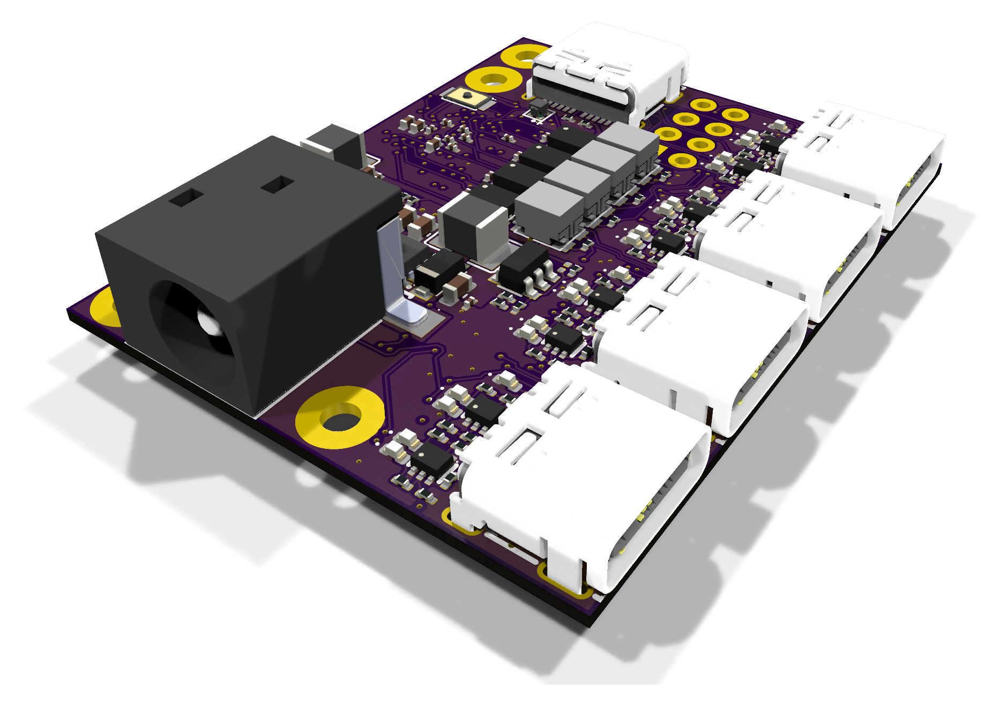
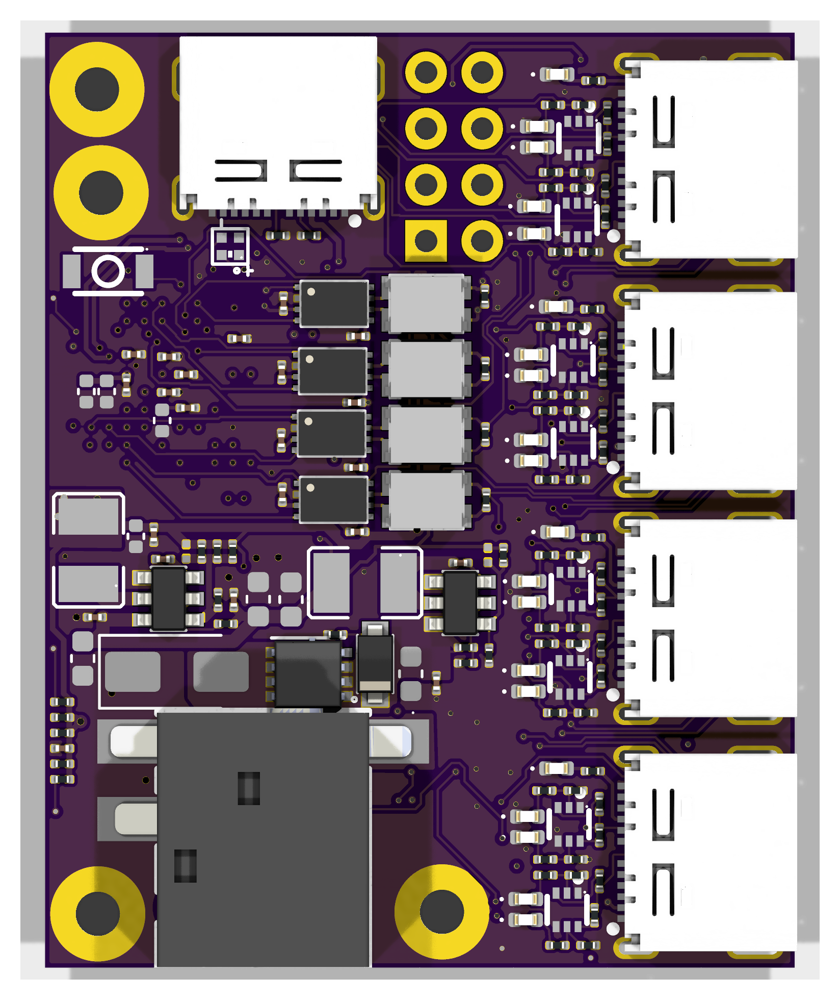
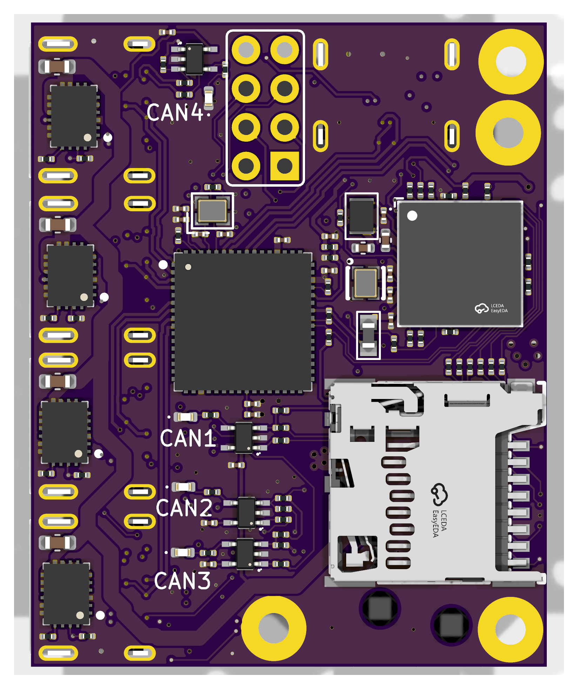

<h1>My PCBGolf entry</h1>
<h3>comma.ai's PCBGolf challenge: a 4-port CAN-FD dev board on a 35 × 43 × 9.3 mm PCBA</h3>

  <a href="https://github.com/commaai/PCBGolf">Original challenge</a>
   · 
  <a href="https://comma.ai/leaderboard#pcbgolf_challenge">Leaderboard</a>
   · 
  <a href="https://kicanvas.org/?github=https%3A%2F%2Fgithub.com%2Fulyssecrn%2FPCBGolf%2Fblob%2Fmaster%2Fpcbgolf.kicad_pcb">View my layout in KiCanvas</a>

  

[PCBGolf](https://github.com/commaai/PCBGolf) is a challenge from comma.ai: take their reference board, loosely based on the panda jungle, and make the assembled PCBA as small as possible while keeping every interface working and every mating connector compatible. The board must be manufacturable and assemblable at JLCPCB. The score is

**bounding-box volume (mm³) + 50 × vias + 5,000 × copper layers**, lowest wins.

This repo is my submitted entry, finished on the October 12, 2026 deadline. The schematic is comma's. The layout, part choices and the design changes below are mine. comma's original README is kept unchanged [at the bottom](#original-challenge-readme).

## Result

| | |
|---|---|
| PCBA bounding box | 34.98 × 43.00 × 9.32 mm (includes the USB-C connector overhang) |
| Board outline | 33.9 × 42.3 mm, 0.79 mm thick |
| Copper layers | 4: signal / power / ground / signal |
| Vias | 303, all through-hole |
| Parts | 253, on both sides |
| **Score (by the formula)** | 14,027 + 15,150 + 20,000 = **≈ 49,200** |

The official score is assigned by comma after review.

<table>
  <tr>
    <td></td>
    <td></td>
  </tr>
  <tr>
    <td align="center">Top: connectors, CAN transceivers and chokes, power supplies</td>
    <td align="center">Bottom: STM32 (TFBGA-100), USB hub, microSD, port eFuses</td>
  </tr>
</table>

## What I changed

- **Stackup and placement.** 4 layers with an unbroken ground plane on In2. Parts on both sides: the STM32 and the USB hub on the bottom, the CAN transceivers and common-mode chokes on top, all six connectors on two edges.
- **MCU package: LQFP-144 → TFBGA-100.** I first tried the 7 × 7 mm UFBGA-169. At 0.5 mm pitch its inner balls carry signals and cannot be escaped on 4 layers without blind or buried vias. The 8 × 8 mm TFBGA-100 at 0.8 mm pitch escapes with ordinary dogbone vias.
- **Package change without touching the schematic.** The BGA footprint's pads are renamed to the LQFP-144 symbol's pin numbers, so comma's symbol keeps working and only the pins that don't exist on the smaller package needed rewiring.
- **Pin assignment as a routing tool.** Ports F and G aren't bonded out on TFBGA-100, so CAN2 moved to other FDCAN3 pins, and the SBU voltage-sense and current-monitor inputs moved to other ADC pins. I also re-ordered the 24 per-port control signals by channel so they leave the BGA in the same order as the connectors. All of this is a firmware pin-map change, which the rules allow (full table below).
- **Smaller parts.** 0201/0402 passives, 2016 crystals, smaller inductors, LEDs and dual FETs, a stemless 1.28 mm Molex microSD socket, and a TLV9101 (SC-70-5) in place of the SOT-23-5 op-amps that drive the CAN activity LEDs.

## Why the score isn't higher on the leaderboard

The penalties for layers and vias outweigh size. On this board, **layers (20,000) and vias (15,150) make up 71% of the score**, while the volume itself is only 14,027.

The top entries went the other way: one copper layer and no vias, with a board up to twice the area. Their fixed penalty is 5,000 instead of my 35,150. Once I had committed to a 4-layer board with a BGA, no amount of shrinking could close that gap. A 4-layer board scores 30,000+ before it has any volume at all.

**What I'd do differently:**
- Decide the layer count from the scoring formula first, and treat board area as the variable to give up.
- Pick an MCU package that can be routed on one or two layers (QFN/LQFP), even if it is larger.
- Watch the height. The DC barrel jack alone sets about 75% of the board's 9.3 mm height.

## Firmware changes

The MCU is an STM32H725VGH6 (TFBGA-100), the same die as the reference STM32H725ZGT (LQFP-144). Power, USB and clock setup are unchanged.

Pin map changes (reference → this board)

| Signal | Reference | This board | Notes |
|---|---|---|---|
| CAN2_TX / CAN2_RX | PG9 / PG10 | PD13 / PD12 | same FDCAN3 peripheral |
| BTN (GPIO read) | PE15 | PE5 | button still also drives BOOT0 |
| CH2_SBU2 sense | PF7 | PA3 | ADC12_INP15 (was ADC3) |
| CH4_SBU2 sense | PF8 | PA2 | ADC12_INP14 (was ADC3) |
| CH2_SBU1 sense | PF9 | PC5 | ADC12_INP8 (was ADC3) |
| CH4_SBU1 sense | PF10 | PB0 | ADC12_INP9 (was ADC3) |
| CH2_IMON | PB1 | PA6 | ADC12_INP3 |
| CH3_IMON | PF11 | PA5 | ADC12_INP19 |
| CH4_IMON | PA6 | PB1 | ADC12_INP5 |
| CH4_PWR_EN | PA5 | PA7 | |
| CH1_SBU1_IGN / RELAY | PD0 / PD1 | PD6 / PD3 | |
| CH1_SBU2_IGN | PD3 | PE0 | |
| CH2_SBU1_IGN / RELAY | PD5 / PD6 | PD1 / PE1 | |
| CH2_SBU2_IGN / RELAY | PD8 / PD10 | PD0 / PD5 | |
| CH3_SBU1_IGN / RELAY | PD12 / PD11 | PD14 / PD15 | |
| CH3_SBU2_IGN / RELAY | PD9 / PD13 | PE7 / PD11 | |
| CH4_SBU1_IGN / RELAY | PD14 / PD15 | PD9 / PE8 | |
| CH4_SBU2_IGN / RELAY | PE0 / PE1 | PD8 / PD10 | |

All other signals keep their reference pins.

## Files

- `pcbgolf.kicad_pro`: KiCad 10 project (the schematics are comma's, the layout is mine)
- `lib_jlc/`, `pcbgolf.pretty/`: footprints, symbols and 3D models; all paths are project-relative
- `assets/renders/`: the renders above, made with `kicad-cli pcb render`

 

---

*Everything below is comma.ai's original challenge README, unchanged.*

<h1>PCBGolf Challenge</h1>
<h3>How small can you make this PCBA?</h3>
<h3>
  <a href="https://comma.ai/leaderboard#pcbgolf_challenge">Leaderboard</a>
   · 
  <a href="https://comma.ai/jobs">comma.ai/jobs</a>
   · 
  <a href="https://discord.comma.ai">Discord</a>
   · 
  <a href="https://x.com/comma_ai">X</a>
</h3>

## The Board

The schematic is loosely based on [our panda jungle v2](https://www.comma.ai/shop/panda-jungle), a development and debugging board for comma devices and pandas. This version includes:

* 12V DC input with onboard 5V and 3.3V supplies
* Four [OBD-C](https://github.com/commaai/hardware/blob/master/harness/OBD-C.sch.pdf) device ports with individually controlled power and current monitoring
* Four CAN-FD transceivers and ignition simulation circuitry
* A USB hub and USB-C host connection
* A microcontroller and microSD card slot
* A push button and status LEDs

Explore in your browser with KiCanvas: [PCB layout](https://kicanvas.org/?github=https%3A%2F%2Fgithub.com%2Fcommaai%2FPCBGolf%2Fblob%2Fmaster%2Fpcbgolf.kicad_pcb).

Schematics: [Power](https://kicanvas.org/?github=https%3A%2F%2Fgithub.com%2Fcommaai%2FPCBGolf%2Fblob%2Fmaster%2Fpcbgolf.kicad_sch) · [Microcontroller](https://kicanvas.org/?github=https%3A%2F%2Fgithub.com%2Fcommaai%2FPCBGolf%2Fblob%2Fmaster%2Fpcbgolf_2.kicad_sch) · [USB & microSD](https://kicanvas.org/?github=https%3A%2F%2Fgithub.com%2Fcommaai%2FPCBGolf%2Fblob%2Fmaster%2Fpcbgolf_3.kicad_sch) · [CAN](https://kicanvas.org/?github=https%3A%2F%2Fgithub.com%2Fcommaai%2FPCBGolf%2Fblob%2Fmaster%2Fpcbgolf_4.kicad_sch) · [OBD-C ports](https://kicanvas.org/?github=https%3A%2F%2Fgithub.com%2Fcommaai%2FPCBGolf%2Fblob%2Fmaster%2Fpcbgolf_5.kicad_sch)

## The Challenge

Your goal is to make the most compact, efficient board that retains the same interfaces and functionality as the original design. The lowest score wins.

  <picture>
    <source media="(prefers-color-scheme: dark)" srcset="./assets/score-dark.svg">
    
  </picture>

### Rules

* The bare PCB must be fully manufacturable by JLCPCB.
* It must be possible to actually assemble the PCBA.
* The assembled product must work and be usable.
* Mating connectors must remain mechanically and electrically compatible.
* Optimizations that require firmware changes are allowed.

### Prize

Lowest score on the [leaderboard](https://comma.ai/leaderboard#pcbgolf_challenge) by **October 12, 2026** wins **$1,000 cash**.

## Submission

Submit a `.zip` file containing your finalized KiCad project and a STEP file of the final assembly [here](https://forms.gle/US88Hg7UR6bBuW3BA).
Competitive scores will be posted on the [leaderboard](https://comma.ai/leaderboard#pcbgolf_challenge) after review. Multiple submissions allowed.
